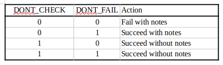
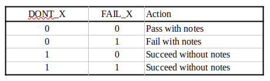

<!--
  ~ Copyright 2026 Cybersecurity and Infrastructure Security Agency (CISA)
  ~
  ~ This software is released to the public domain under 17 U.S.C. § 105.
  ~ The Apache 2.0 license applies to the extent permitted by applicable law,
  ~ and for the benefit of international users.
-->

# Server Edge Validation Administration

The CISA server provides a highly configurable edge validation scheme for
incoming STIX objects (via the `taxii/v2.1-os/api-root/collections/cId/objects/` endpoint).
Newly created api-root / collection pairs by default have the most strict validation;
validation aspects must be relaxed via these administration endpoints to allow non-compliant
objects to be accepted and persisted.  Many of the options have two facets:

- perform the check, reporting results in the detailed status response, and
- fail an object if the check indicated non-compliance

In other words, object compliance can be evaluated and reported, but the option exists
to accept them regardless.  Validation and potential action are controlled by a set
of enumerations.  Associating these values with a collection provides lenience
on objects intended for inclusion.
These values may also be applied to an api-root; these form a set of default
leniencies for the collections available within that api-root.  When in doubt,
leave api-root leniencies empty and assign collection leniencies with malice
and forethough.

The enumerations are as follows and will be discussed individually in a later section;
they are presented here to provide flavor for the administration endpoint presentation...

- `DONT_CHECK_CUSTOM_OBJECTS`
- `DONT_CHECK_CUSTOM_PROPERTIES`
- `DONT_CHECK_DUPLICATES`
- `DONT_CHECK_NA_COMMONS`
- `DONT_CHECK_REVOKED`
- `DONT_EXTENSION_VALIDATE`
- `DONT_FAIL_CREATOR_CONFLICTS`
- `DONT_FAIL_CUSTOM_OBJECTS`
- `DONT_FAIL_CUSTOM_PROPERTIES`
- `DONT_FAIL_DUPLICATES`
- `DONT_FAIL_EXTENSION_INVALID`
- `DONT_FAIL_IF_REVOKED`
- `DONT_FAIL_MITRE_INVALID`
- `DONT_FAIL_NA_COMMONS`
- `DONT_MITRE_VALIDATE`
- `DONT_REMOVE_EMPTY_ARRAYS`
- `DONT_RESPECT_CREATOR`
- `DONT_TRIM_URLS`
- `FAIL_EMPTY_ARRAYS`
- `FAIL_TRIMMED_URLS`
- `REPLACE_SCOS`
- `DONT_CHECK_SCO_IDS`

With any luck, the names provide some indication of the intent and scope of validation options.

## Endpoints

Examples will be included as necessary.  They unavoidably refer to some specific leniences;
read ahead in the appropriate sections for clarification.
The examples will focus on handling collection leniencies
and their effects;
handling api root leniencies and their effects are parallel.

`GET admin/v1.0/lenients` provides a list of valid enumeration values (the list above was
generated with this endpoint)

`GET admin/v1.0/api-root/{api-root-name}/lenients` and
`GET admin/v1.0/api-root/{api-root-name}/{collection-id}/lenients` return the current
set of leniency flags for the named api root and api root / collection pair respectively.
It should be noted that an empty array is the most strict (no leniencies).
Also the api root / collection pair endpoint returns the literal leniencies for
that collection in the context of the api root.
It does **NOT** reflect, in the case of collection leniencies being empty but
api root leniencies being not empty, the effective default leniencies...

Example:

```
curl -k --user 'imx-admin:$TAXII_PASSWORD' https://localhost:9443/admin/v1.0/api-root/Send2A1/raw/lenients/
```

replies

```
[]
```

The collection `raw` on api root `Send2A1` currently has no leniencies.  Posting

```
{
	"objects": [
		{
			"object_marking_refs": [
				"marking-definition--fa42a846-8d90-4e51-bc29-71d5b4802168"
			],
			"id": "x-mitre-data-component--02d090b6-8157-48da-98a2-517f7edd49fd",
			"type": "x-mitre-data-component",
			"created": "2021-10-20T15:05:19.274Z",
			"created_by_ref": "identity--c78cb6e5-0c4b-4611-8297-d1b8b55e40b5",
			"modified": "2022-04-25T14:00:00.188Z",
			"name": "Active Directory Credential Request",
			"description": "A user requested active directory credentials, such as a ticket or token (ex: Windows EID 4769)",
			"x_mitre_data_source_ref": "x-mitre-data-source--d6188aac-17db-4861-845f-57c369f9b4c8",
			"x_mitre_version": "1.0",
			"x_mitre_attack_spec_version": "2.1.0",
			"x_mitre_modified_by_ref": "identity--c78cb6e5-0c4b-4611-8297-d1b8b55e40b5",
			"spec_version": "2.1",
			"x_mitre_domains": [
				"enterprise-attack"
			]
		}
	]
}
```

replies a status of

```
{
  "id": "354a3c3f-1066-4762-83a0-e6c5a24e09eb",
  "status": "complete",
  "total_count": 1,
  "success_count": 0,
  "failure_count": 1,
  "pending_count": 0,
  "request_timestamp": "2024-05-22T12:22:58.532167Z",
  "failures": [
    {
      "id": "x-mitre-data-component--02d090b6-8157-48da-98a2-517f7edd49fd",
      "version": "2022-04-25T14:00:00.188Z",
      "message": "x-mitre-data-component--02d090b6-8157-48da-98a2-517f7edd49fd/2022-04-25T14:00:00.188Z is a custom objects\ncustom property .x_mitre_attack_spec_version removed\ncustom property .x_mitre_data_source_ref removed\ncustom property .x_mitre_domains removed\ncustom property .x_mitre_modified_by_ref removed\ncustom property .x_mitre_version removed\n"
    }
  ]
}
```

An empty set of leniencies enforces all validation options - is strict - and flags / fails this
object since it uses deprecated custom object and custom properties.

`POST admin/v1.0/api-root/{api-root-name}/lenients` takes a JSON array of enumeration
values and sets the leniencies for the api-root,
replacing any previous values (recall that these are the default values
for all contained collections)

`POST admin/v1.0/api-root/{api-root-name}/{collection-id}/lenients` takes a JSON array of enumeration
values and sets the leniencies for the collection within the context of the specified api-root,
replacing any previous values

After

```
curl -k --user 'imx-admin:$TAXII_PASSWORD' https://localhost:9443/admin/v1.0/api-root/Send2A1/raw/lenients -H 'Content-Type: application/taxii+json' -d '[ "DONT_FAIL_CUSTOM_OBJECTS", "DONT_FAIL_CUSTOM_PROPERTIES" ]'
```

the same object post returns

```
{
  "id": "92f30ebf-11a5-47ee-9351-2d73ceaae40d",
  "status": "complete",
  "total_count": 1,
  "success_count": 1,
  "failure_count": 0,
  "pending_count": 0,
  "request_timestamp": "2024-05-22T12:31:10.396942Z",
  "successes": [
    {
      "id": "x-mitre-data-component--02d090b6-8157-48da-98a2-517f7edd49fd",
      "version": "2022-04-25T14:00:00.188Z",
      "message": "x-mitre-data-component--02d090b6-8157-48da-98a2-517f7edd49fd/2022-04-25T14:00:00.188Z is a custom objects\ncustom property .x_mitre_attack_spec_version removed\ncustom property .x_mitre_data_source_ref removed\ncustom property .x_mitre_domains removed\ncustom property .x_mitre_modified_by_ref removed\ncustom property .x_mitre_version removed\ncreated\n"
    }
  ]
}
```

flagging the deprecated usages but allowing the object nonetheless.

`POST admin/v1.0/api-root/{api-root-name}/lenients/add`
and
`POST admin/v1.0/api-root/{api-root-name}/lenients/remove`
take a JSON array of enumeration values and respectively add or remove them from the
existing value set for the api-root

`POST admin/v1.0/api-root/{api-root-name}/{colleciton-id}/lenients/add`
and
`POST admin/v1.0/api-root/{api-root-name}/{collection-id}/lenients/remove`
take a JSON array of enumeration values and respectively add or remove them from the
existing value set for the collection within the context of the specified api-root.

After the examples above

```
curl -k --user 'imx-admin:$TAXII_PASSWORD' https://localhost:9443/admin/v1.0/api-root/Send2A1/raw/lenients
```

replies

```
[
  "DONT_FAIL_CUSTOM_PROPERTIES",
  "DONT_FAIL_CUSTOM_OBJECTS"
]
```

posting the object

```
{
	"objects": [
		{
			"type": "ipv4-addr",
			"id": "ipv4-addr--5c0b2084-60bb-4880-ace9-4388e05226ed",
			"value": "192.0.2.206",
			"created": "2022-03-30T13:00:00.000Z",
			"modified": "2022-03-31T13:00:00.000Z"
		}
	]
}
```

replies

```
{
  "id": "bd7cd56b-a4ba-407b-afe3-71324347f5d8",
  "status": "complete",
  "total_count": 1,
  "success_count": 0,
  "failure_count": 1,
  "pending_count": 0,
  "request_timestamp": "2024-05-22T14:02:12.455725Z",
  "failures": [
    {
      "id": "ipv4-addr--5c0b2084-60bb-4880-ace9-4388e05226ed",
      "version": "2022-03-31T13:00:00.000Z",
      "message": "has not applicable property created\nhas not applicable property modified\n"
    }
  ]
}
```

Apparently we need to be more lenient.
Assuming we'd like to accept this bogus SCO (and others having similar problems)
and not even hear about the problems, we

```
curl -k --user 'imx-admin:$TAXII_PASSWORD' https://localhost:9443/admin/v1.0/api-root/Send2A1/raw/lenients/add -d '["DONT_CHECK_NA_COMMONS"]' -H 'Content-Type: application/taxii+json'
```

check the leniencies

```
curl -k --user 'imx-admin:$TAXII_PASSWORD' https://localhost:9443/admin/v1.0/api-root/Send2A1/raw/lenients
```

receiving

```
[
  "DONT_FAIL_CUSTOM_OBJECTS",
  "DONT_FAIL_CUSTOM_PROPERTIES",
  "DONT_CHECK_NA_COMMONS"
]
```

repost and get

```
{
  "id": "175870ff-4245-4042-9be1-764c247e196e",
  "status": "complete",
  "total_count": 1,
  "success_count": 1,
  "failure_count": 0,
  "pending_count": 0,
  "request_timestamp": "2024-05-22T14:38:57.101873Z",
  "successes": [
    {
      "id": "ipv4-addr--5c0b2084-60bb-4880-ace9-4388e05226ed",
      "version": "2022-03-31T13:00:00.000Z",
      "message": "created\n"
    }
  ]
}
```

No blood, no foul.  We might have added the leniency `DONT_FAIL_NA_COMMONS`
instead in
which case we would receive the warning but the object would still succeed.

## Enumeration Values

The enumeration pairs

- `DONT_CHECK_CUSTOM_OBJECTS` - `DONT_FAIL_CUSTOM_OBJECTS`
- `DONT_CHECK_CUSTOM_PROPERTIES` - `DONT_FAIL_CUSTOM_PROPERTIES`
- `DONT_CHECK_DUPLICATES` - `DONT_FAIL_DUPLICATES`
- `DONT_CHECK_NA_COMMONS` - `DONT_FAIL_NA_COMMONS`
- `DONT_CHECK_REVOKED` - `DONT_FAIL_IF_REVOKED`
- `DONT_EXTENSION_VALIDATE` - `DONT_FAIL_EXTENSION_INVALID`
- `DONT_RESPECT_CREATOR` - `DONT_FAIL_CREATOR_CONFLICTS`
- `DONT_MITRE_VALIDATE` - `DONT_FAIL_MITRE_INVALID`

follow this truth table



The enumeration pairs

- `DONT_REMOVE_EMPTY_ARRAYS` - `FAIL_EMPTY_ARRAYS`
- `DONT_TRIM_URLS`- `FAIL_TRIMMED_URLS`

follow this truth table



It should be noted that *succeed* in this context implies for
this particular validation facet. It is entire possible that
another facet will fail an object with these anomalies
(for instance, the MITRE
validator will flag URLs with leading and/or trailing
whitespace).

Finally

- `REPLACE_SCOS`

is simply a binary: if included then SCOs are replaced otherwise
duplicate `id`s are failed with details

### `DONT_CHECK_CUSTOM_OBJECTS`

The STIX specification has deprecated custom objects in favor of the extension mechanism.
By default, the server rejects those deprecated objects; including this leniency
allows the deprecated custom object style.
The returned status message will **NOT** include any mention of this potential issue.

### `DONT_FAIL_CUSTOM_OBJECTS`

When specified without `DONT_CHECK_CUSTOM_OBJECTS`, custom objects will be
identified in the status message but still accepted.
If `DONT_CHECK_CUSTOM_OBJECTS` is absent, this leniency is moot
(can't fail if you don't check).

### `DONT_CHECK_CUSTOM_PROPERTIES`

The STIX specification has deprecated custom properties within object in favor
of the extension mechanism.  By default, the server rejects objects with custom
properties; including this leniency allows objects with custom properties to be accepted.
The returned status message will **NOT** include any mention of this potential issue.

### `DONT_FAIL_CUSTOM_PROPERTIES`

When specified without `DONT_CHECK_CUSTOM_PROPERTIES`, custom properties will be
identified in the status message but still accepted.
If `DONT_CHECK_CUSTOM_PROPERTIES` is absent, this leniency is moot
(can't fail if you don't check).

### `DONT_CHECK_DUPLICATES`

While the best practice documents provide guidance on updating objects, that is,
updating the *modified* member, the TAXII specification proper does not provide
**MUST** direction on the server action when presented with a previously
received object.  Our server strongly defines the *id*/*version* pair as the
globally unique key for objects and, by default, rejects identical objects;
including this leniency prevents messages indicating potential conflicts.
The word **conflict** is used since, in the absence of other leniencies, objects
with the same global identifier but different content will **NOT** replace
the existing content.
See `REPLACE_SCOS` for a related leniency...

### `DONT_FAIL_DUPLICATES`

When specified without `DONT_CHECK_DUPLICATES`, duplicate objects
(those with previously seen *id*/*version* pairs) will be
identified in the status message but still accepted.
If `DONT_CHECK_DUPLICATES` is absent, this leniency is moot
(can't fail if you don't check).

### `DONT_CHECK_NA_COMMONS`

The STIX specification identifies common object members that are not applicable
to specific object types; our server enforces this constraint as an error by default.
Including this leniency allows e.g. *created* members in `SCOs`...

### `DONT_FAIL_NA_COMMONS`

When specified without `DONT_CHECK_NA_COMMONS`, objects
having members identified in the specification as *not applicable* will be
identified in the status message but still accepted.
If `DONT_CHECK_NA_COMMONS` is absent, this leniency is moot
(can't fail if you don't check).

### `DONT_CHECK_REVOKED`

The STIX specification requires that once a version of an object is submitted
that has the *revoked* member `true`, no further versions of the objects are allowed.
The server strongly enforces this restriction by default; including this leniency
informs the server to accept other-versioned objects.  It should be noted that the
server does not, in this or any other case, acknowledge ordering during object submission
(based on the version - a timestamp).  However, of course, the version ordering is
respected in the context of version searching (`first`, `last`, `all`).

### `DONT_FAIL_IF_REVOKED`

When specified without `DONT_CHECK_REVOKED`, objects
with unique versions submitted after one with *revoked* set will be
identified in the status message but still accepted.
If `DONT_CHECK_REVOKED` is absent, this leniency is moot
(can't fail if you don't check).

### `DONT_EXTENSION_VALIDATE`

Custom extension are defined within `extension-definiion` objects; these objects have
a *schema* member which indicates (in multiple ways - refer to spec) a JSON Schema with
which the object content can be validated.  The server recognizes incoming objects with
extensions, attempts to locate the definition, follows the definition to the schema,
and then, by default, validates the object content against the JSON Schema.
Challenges abound.  The definition object might not have been provided and/or can't
be found (and the spec is ambiguous as to where it should be found anyway).  The
definition is not required to declare a schema.  The data in the *schema* field may
not be resolvable.  The technical committee's intent is good; the implementation is
difficult.  Including this leniency prevents all attempts at validating extension
content; the dangerous implication is that downstream machine interpretation of the
content will be broken.

### `DONT_FAIL_EXTENSION_INVALID`

When specified without `DONT_EXTENSION_VALIDATE`, missing schema /
invalid object content will be
identified in the status message but still accepted.
If `DONT_EXTENSION_VALIDATE` is absent, this leniency is moot
(can't fail if you don't check).

### `DONT_RESPECT_CREATOR`

The best practices documents strongly indicates that only the originating creator
of an object can issue updated versions; the server enforces this by default.
Including this leniency prevents status messages
(and object failures) and forces the server to ignore
*created_by_ref* inter-version conflicts.

### `DONT_FAIL_CREATOR_CONFLICTS`

When specified without `DONT_RESPECT_CREATOR`,
*created_by_ref* conflicts on object versions will be noted, but
objects will be accepted regardless.
If `DONT_RESPECT_CREATOR` is absent, this leniency is moot.

### `DONT_REMOVE_EMPTY_ARRAYS`

While the STIX specification is clear that members of type array whose values
are empty are **NOT** to be included (in the serialized form),
we have seen many outside object providers include them nonetheless.
In the interest of being inclusive (and not imposing addition administrative
duties) and, since the remedy is deterministic and simple,
we have chosen to remove empty arrays by default
(reporting the anomaly in the status message).
Including this flag forces the
server to leave empty arrays untouched (potentially being flagged
by later, more specific, validation capabilities / features).

### `FAIL_EMPTY_ARRAYS`

When specified without `DONT_REMOVE_EMPTY_ARRAYS`,
members with empty array values will be noted and failed.
If `DONT_REMOVE_EMPTY_ARRAYS` is present, this leniency is moot.

### `DONT_MITRE_VALIDATE`

MITRE, a prime mover in the STIX / TAXII community, provides an
[object validating capability](https://github.com/oasis-open/cti-stix-validator).
The server, by default, applies this validator to all incoming objects.
Including this leniency bypasses this check.

### `DONT_FAIL_MITRE_INVALID`

When specified without `DONT_MITRE_VALIDATE`,
non-complient objects (in the opinion of MITRE) will be noted, but the object will
be accepted in the form presented.
If `DONT_MITRE_VALIDATE` is absent, this leniency is moot.

### `DONT_TRIM_URLS`

While the STIX specification is clear that members of type URL
must be valid URI (go figure) values,
we have seen many outside object providers
inadvertently include leading and/or trailing whitespace
(invalidating the object in the most strict sense).
In the interest of being inclusive (and not imposing addition administrative
duties) and, since the remedy is deterministic and simple,
we have chosen to trim leading and trailing whitespace by default
(reporting the anomaly in the status message).
Including this flag forces the
server to leave URL fields untouched (potentially being flagged
by later, more specific, validation capabilities / features).

### `FAIL_TRIMMED_URLS`

When specified without `DONT_TRIM_URLS`, URL
members with leading and/or trailing whitespace will be noted and failed.
If `DONT_TRIM_URLS` is present, this leniency is moot.

### `DONT_CHECK_SCO_IDS`

The standard states that the UUID portion of SCO objects
(excluding the `process` object type)
**SHOULD** be a UUIDv5 computed from a type-specific
list of id-contributing members within the
`00abedb4-aa42-466c-9c01-fed23315a9b7` namespace.
By default (this leniency *not* specified),
SCO id UUID portions are validated and noted;
objects are passed by default
(due to the **SHOULD** nature of the requirement)
provided `FAIL_SCO_IDS` is not specified,

### `FAIL_SCO_IDS`

When specified without `DONT_CHECK_SCO_IDS`,
id UUIDs on SCOs that don't match the UUIDv5 computed
from the id-contributing members will be noted and failed.
If `DONT_CHECK_SCO_IDS` is present, this leniency is moot.

###`REPLACE_SCOS`

SCOs, in this author's opinion an unfortunate artifact from previous STIX standard versions,
have *created* and *modified* members as *not applicable*.  As such, they have no *version*.
Recalling earlier discussion about globally unique identification by *id*/*version* pair,
this implies that SCOs can **NEVER** be updated / revised.  Per the STIX specification,
the *id* of a SCO is a `UUIDv5` derived from specific fields within; however, this is
a **SHOULD**, not a **MUST**.  In practice, the author has seen many, many objects from
government and commercial sites alike that provide SCOs with `UUIDv4`. These objects
are effectively data dead-ends...

This leniency provides a mechanism for coping with `UUIDv4`-labeled SCOs.  When included,
the object request is treated as a **REPLACE** rather than an **INSERT** (to loosely use
SQL terms).
